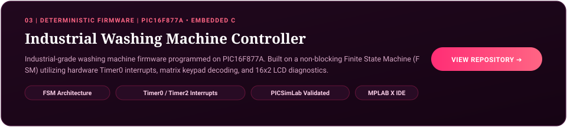
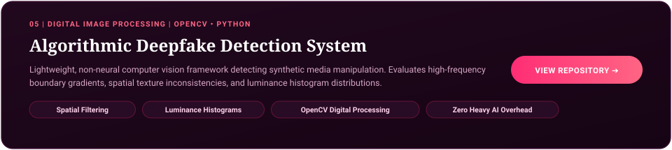
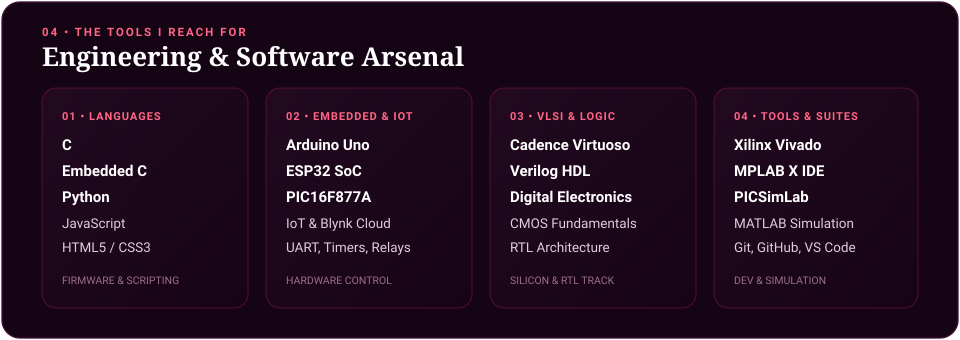

  

 

<!-- HERO BANNER (NO OVERARCHING HYPERLINK) -->

  

<!-- HERO ACTION BUTTONS (INDIVIDUALLY HYPERLINKED) -->

  
  &nbsp;
  
  &nbsp;
  
  &nbsp;
  

<!-- SRM UNIVERSITY AP OFFICIAL SEAL / LOGO -->

  

 

<!-- ABOUT SECTION -->

  

<!-- METRICS BAR -->

  

<!-- SELECTED WORK HEADER -->

  

<!-- PROJECT 1: DRIVER DROWSINESS DETECTION -->

  

<!-- PROJECT 2: ESP32 SMART HOME AUTOMATION -->

  

<!-- PROJECT 3: WASHING MACHINE CONTROLLER -->

  

<!-- PROJECT 4: WEATHER MONITORING SYSTEM -->

  

<!-- PROJECT 5: DEEPFAKE DETECTOR -->

  

<!-- PROJECT 6: 3D DEVELOPER PORTFOLIO -->

  

<!-- SKILLS GRID -->

  

<!-- GITHUB STATS & STREAK (BURGUNDY THEME) -->

  
  &nbsp;&nbsp;
  

 

<!-- CREDENTIALS & CERTIFICATIONS -->

  

<!-- CONNECT & CONTACT BANNER -->

  

  <a href="https://portfolio-beta-rust-xm0g3t4cy3.vercel.app/" target="_blank"><b>Live Portfolio</b></a> •
  <a href="https://www.linkedin.com/in/varsha-kumar-b64822343/" target="_blank"><b>LinkedIn</b></a> •
  <a href="mailto:varshakumarballi@gmail.com"><b>Email</b></a> •
  <a href="https://github.com/Varshakumar-06?tab=repositories"><b>All Repositories</b></a>

