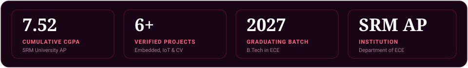
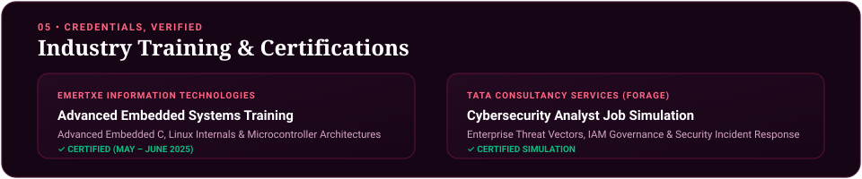

<!-- ========================================== -->
<!-- 🚀 TOP PRIORITY: LIVE 3D PORTFOLIO WEBSITE -->
<!-- ========================================== -->

  

### [🚀 EXPLORE MY LIVE 3D PORTFOLIO WEBSITE ➔](https://portfolio-beta-rust-xm0g3t4cy3.vercel.app/)

  

  
  
  
  

---

<!-- ========================================== -->
<!-- 01 • ABOUT SECTION                         -->
<!-- ========================================== -->

  

<!-- ========================================== -->
<!-- 02 • PROOF, ON THE RECORD (METRICS ROW)    -->
<!-- ========================================== -->

  

---

<!-- ========================================== -->
<!-- 03 • SELECTED WORK (FEATURED PROJECTS)     -->
<!-- ========================================== -->

  

<!-- Project 1: Driver Drowsiness Detection System -->

  

<!-- Project 2: ESP32 Smart Home Automation -->

  

<!-- Project 3: Automatic Washing Machine Controller (PIC16F877A) -->

  

<!-- Project 4: IoT Weather Monitoring Terminal -->

  

<!-- Project 5: Deepfake Detection System -->

  

<!-- Project 6: Interactive 3D Developer Portfolio -->

  

---

<!-- ========================================== -->
<!-- 04 • TECHNICAL ARSENAL                     -->
<!-- ========================================== -->

  

---

<!-- ========================================== -->
<!-- 05 • COMMIT LOG & DEVELOPER ANALYTICS      -->
<!-- ========================================== -->

### 📊 05 • COMMIT LOG & DEVELOPER METRICS
*A continuous pursuit of engineering excellence, one square at a time.*

 

 

---

<!-- ========================================== -->
<!-- 06 • CREDENTIALS, VERIFIED                 -->
<!-- ========================================== -->

  

---

<!-- ========================================== -->
<!-- 07 • CONNECT & COLLABORATE                 -->
<!-- ========================================== -->

  

 

**B. Varsha Kumar**  
Electronics & Communication Engineering Undergraduate • **SRM University AP** (Class of 2027)  
🌐 [Live 3D Portfolio](https://portfolio-beta-rust-xm0g3t4cy3.vercel.app/) • 💼 [LinkedIn Profile](https://www.linkedin.com/in/varsha-kumar-b64822343/) • ✉️ [varshakumarballi@gmail.com](mailto:varshakumarballi@gmail.com)

